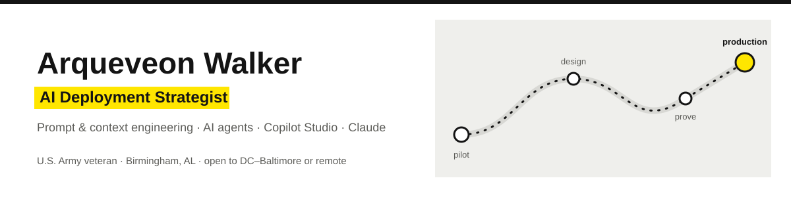
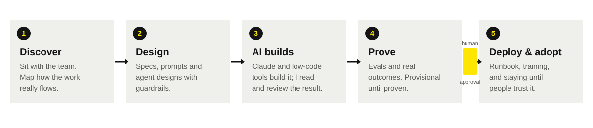

<picture>
  <source media="(prefers-color-scheme: dark)" srcset="assets/banner-dark.svg">
  
</picture>

**AI deployment strategist.** I take AI from pilot to production with the people who actually use it.

---

### What I do

I sit with the team that owns a problem, map how the work really flows, design the AI solution, and stay until it runs in production and people trust it.

My core skill is **prompt and context engineering**: I write the specs, prompts and agent designs that AI builds from, with guardrails and human approval before anything acts. I read and review the code that results; I don't write it from scratch.

At a large utility, that meant:
- A **Power Automate** invoice-routing flow for Accounts Payable across 18 operating companies, replacing an end-of-life scanning setup at zero net-new software cost
- **Copilot Studio** agents my team used daily, plus Copilot enablement sessions and a prompting guide for business partners outside IT
- A framework to **measure the return on Copilot adoption**, separating self-reported value from telemetry-backed value
- A rules-based **predictive device-failure system** over endpoint telemetry for a 5,000+ device fleet

### Featured work

| Repo | What it shows |
|---|---|
| [sentinel-demo](https://github.com/arqueveon96-eng/sentinel-demo) | A weekly device-health loop (score, investigate, draft tickets, validate). I designed and specified it; Claude wrote the React/TypeScript code from my specs, with 235 tests. Runs on synthetic data. |
| [human-in-the-loop-agents](https://github.com/arqueveon96-eng/human-in-the-loop-agents) | How I run a multi-agent AI platform where agents draft, humans approve, and every agent is generated from an audited charter |

### How I work with AI

I design and specify, AI builds, and I review and test. My rules:
- **Draft by default.** Nothing outward-facing happens without a human yes.
- **Provisional until proven.** New scores, prompts and models stay labeled provisional until real outcomes validate them.
- **Least privilege.** Agents get only the tools their job needs.
- **Every claim has a source.**

### Tools I work in

Copilot Studio · M365 Copilot · Claude · AI agents & MCP · Power Automate · Power Apps · n8n · Power BI · Nexthink · ServiceNow · BMC Helix

📫 [LinkedIn](https://www.linkedin.com/in/arquaveonwalker/)
